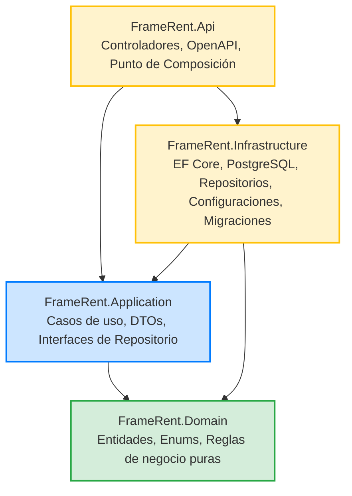
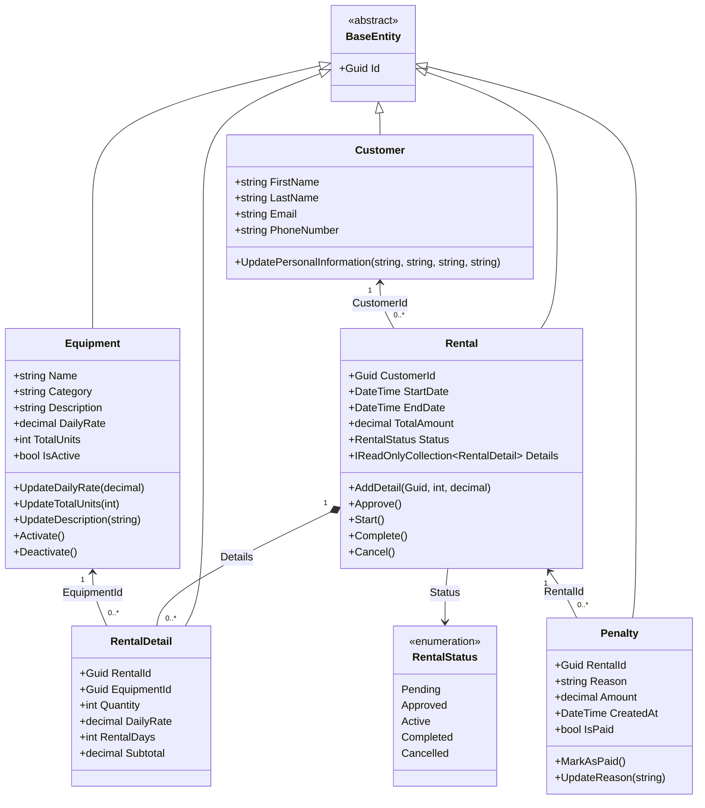

# FrameRent

Sistema de gestión y alquiler de equipos audiovisuales desarrollado con **ASP.NET Core Web API (.NET 10)**, **Entity Framework Core**, **PostgreSQL** y **Clean Architecture** (Arquitectura Limpia), diseñado para integrarse con un cliente frontend desacoplado (Angular).

---

## Tabla de contenidos

1. [Descripción general del proyecto](#1-descripción-general-del-proyecto)
2. [Arquitectura del sistema](#2-arquitectura-del-sistema)
3. [Estructura global de la solución](#3-estructura-global-de-la-solución)
4. [Capa de Dominio (`FrameRent.Domain`)](#4-capa-de-dominio-framerentdomain)
   - [4.1 Descripción y principios](#41-descripción-y-principios)
   - [4.2 Estructura del proyecto](#42-estructura-del-proyecto)
   - [4.3 Entidades y reglas de negocio](#43-entidades-y-reglas-de-negocio)
   - [4.4 Enumeraciones](#44-enumeraciones)
   - [4.5 Interconexión del modelo de dominio](#45-interconexión-del-modelo-de-dominio)
   - [4.6 Diagrama de clases (Mermaid)](#46-diagrama-de-clases-mermaid)
   - [4.7 Consideraciones y reglas del dominio](#47-consideraciones-y-reglas-del-dominio)
5. [Capa de Aplicación (`FrameRent.Application`)](#5-capa-de-aplicación-framerentapplication)
   - [5.1 Descripción y responsabilidades](#51-descripción-y-responsabilidades)
   - [5.2 Estructura del proyecto](#52-estructura-del-proyecto)
   - [5.3 Objetos de Transferencia de Datos (DTOs)](#53-objetos-de-transferencia-de-datos-dtos)
   - [5.4 Interfaces de Repositorio](#54-interfaces-de-repositorio)
   - [5.5 Casos de Uso implementados](#55-casos-de-uso-implementados)
   - [5.6 Inyección de dependencias (`AddApplication`)](#56-inyección-de-dependencias-addapplication)
   - [5.7 Principios de Clean Architecture aplicados](#57-principios-de-clean-architecture-aplicados)
6. [Capa de Infraestructura (`FrameRent.Infrastructure`)](#6-capa-de-infraestructura-framerentinfrastructure)
   - [6.1 Descripción y responsabilidades](#61-descripción-y-responsabilidades)
   - [6.2 Entity Framework Core como ORM](#62-entity-framework-core-como-orm)
   - [6.3 Contexto de persistencia (`FrameRentDbContext`)](#63-contexto-de-persistencia-framerentdbcontext)
   - [6.4 Mapeo de entidades con Fluent API (`Configurations/`)](#64-mapeo-de-entidades-con-fluent-api-configurations)
   - [6.5 Migraciones de esquema (`Migrations/`)](#65-migraciones-de-esquema-migrations)
   - [6.6 Implementación del repositorio (`EquipmentRepository`)](#66-implementación-del-repositorio-equipmentrepository)
   - [6.7 Inyección de dependencias (`AddInfrastructure`)](#67-inyección-de-dependencias-addinfrastructure)
7. [Capa de Presentación / API (`FrameRent.Api`)](#7-capa-de-presentación--api-framerentapi)
   - [7.1 Rol y responsabilidades](#71-rol-y-responsabilidades)
   - [7.2 Punto de composición (`Program.cs`)](#72-punto-de-composición-programcs)
   - [7.3 Controlador de equipos (`EquipmentController`)](#73-controlador-de-equipos-equipmentcontroller)
   - [7.4 Cómo ejecutar la API localmente](#74-cómo-ejecutar-la-api-localmente)
   - [7.5 Pruebas de la API vía HTTP (`FrameRent.Api.http`)](#75-pruebas-de-la-api-vía-http-framerentapihttp)
   - [7.6 Endpoints verificados](#76-endpoints-verificados)
8. [Inyección de dependencias y flujo de una solicitud](#8-inyección-de-dependencias-y-flujo-de-una-solicitud)
   - [8.1 ¿Qué es y por qué se utiliza la Inyección de Dependencias?](#81-qué-es-y-por-qué-se-utiliza-la-inyección-de-dependencias)
   - [8.2 Ciclo de vida de los servicios (Scoped)](#82-ciclo-de-vida-de-los-servicios-scoped)
   - [8.3 Flujo extremo a extremo de una petición HTTP (7 etapas)](#83-flujo-extremo-a-extremo-de-una-petición-http-7-etapas)
9. [Configuración, herramientas y base de datos](#9-configuración-herramientas-y-base-de-datos)
   - [9.1 Cadena de conexión con PostgreSQL](#91-cadena-de-conexión-con-postgresql)
   - [9.2 Herramientas locales de EF Core (`dotnet-tools.json`)](#92-herramientas-locales-de-ef-core-dotnet-toolsjson)
   - [9.3 Ciclo de trabajo con migraciones (Rider y CLI)](#93-ciclo-de-trabajo-con-migraciones-rider-y-cli)
10. [Tecnologías y herramientas](#10-tecnologías-y-herramientas)
11. [Estado actual y próximos pasos](#11-estado-actual-y-próximos-pasos)

---

## 1. Descripción general del proyecto

**FrameRent** es una solución empresarial para la administración, control y alquiler de equipos técnicos y audiovisuales (cámaras, ópticas, iluminación, sonido, herramientas de producción, etc.).

El sistema permite:
- Gestionar el catálogo y stock de equipos con tarifas diarias de alquiler.
- Administrar el registro y datos de clientes.
- Orquestar el ciclo de vida completo de un alquiler (creación, aprobación, inicio, finalización y cancelación).
- Calcular costes automáticos por días y cantidades contratadas.
- Aplicar y controlar penalizaciones o recargos asociados a incidentes o retrasos en los alquileres.

El diseño del backend sigue estrictamente los principios de **Clean Architecture**, asegurando que las reglas del negocio permanezcan completamente aisladas de los detalles técnicos, de los motores de base de datos y de los frameworks externos.

---

## 2. Arquitectura del sistema

La solución se divide en cuatro capas concéntricas donde las dependencias siempre apuntan hacia el núcleo del dominio:



### Responsabilidad de cada capa

| Capa | Proyecto | Responsabilidad principal |
|---|---|---|
| **Domain** | `FrameRent.Domain` | Contiene las entidades, enumeraciones y las reglas del negocio puras. No depende de ninguna otra capa ni biblioteca externa. |
| **Application** | `FrameRent.Application` | Define y orquesta los casos de uso del sistema, declara los DTOs de entrada y expone las interfaces de repositorio necesarias. |
| **Infrastructure** | `FrameRent.Infrastructure` | Implementa el acceso a datos mediante Entity Framework Core, mapeos Fluent API, migraciones de esquema, repositorios concretos y conexión a PostgreSQL. |
| **API** | `FrameRent.Api` | Punto de entrada y composición. Recibe solicitudes HTTP mediante controladores REST, ejecuta los casos de uso y proporciona la configuración de inicio para la aplicación y herramientas de EF Core. |

---

## 3. Estructura global de la solución

```text
FrameRent/
├── FrameRent.slnx
├── README.md
├── dotnet-tools.json
└── src/
    ├── FrameRent.Domain/
    │   ├── Entities/
    │   │   ├── BaseEntity.cs
    │   │   ├── Customer.cs
    │   │   ├── Equipment.cs
    │   │   ├── Penalty.cs
    │   │   ├── Rental.cs
    │   │   └── RentalDetail.cs
    │   └── Enums/
    │       └── RentalStatus.cs
    │
    ├── FrameRent.Application/
    │   ├── DependencyInjection.cs
    │   ├── DTOs/
    │   │   └── Equipment/
    │   │       ├── CreateEquipmentRequest.cs
    │   │       └── UpdateEquipmentRequest.cs
    │   ├── Interfaces/
    │   │   └── Repositories/
    │   │       └── IEquipmentRepository.cs
    │   └── UseCases/
    │       └── EquipmentManagement/
    │           ├── ActivateEquipment/
    │           ├── CreateEquipment/
    │           ├── DeactivateEquipment/
    │           ├── GetAllEquipment/
    │           ├── GetEquipmentById/
    │           └── UpdateEquipment/
    │
    ├── FrameRent.Infrastructure/
    │   ├── DependencyInjection.cs
    │   └── Persistence/
    │       ├── Configurations/
    │       │   ├── CustomerConfiguration.cs
    │       │   ├── EquipmentConfiguration.cs
    │       │   ├── PenaltyConfiguration.cs
    │       │   ├── RentalConfiguration.cs
    │       │   └── RentalDetailConfiguration.cs
    │       ├── Migrations/
    │       │   ├── [timestamp]_InitialCreate.cs
    │       │   ├── [timestamp]_InitialCreate.Designer.cs
    │       │   └── FrameRentDbContextModelSnapshot.cs
    │       ├── Repositories/
    │       │   └── EquipmentRepository.cs
    │       └── FrameRentDbContext.cs
    │
    └── FrameRent.Api/
        ├── Controllers/
        │   └── EquipmentController.cs
        ├── FrameRent.Api.http
        ├── appsettings.json
        ├── appsettings.Development.json
        └── Program.cs
```

---

## 4. Capa de Dominio (`FrameRent.Domain`)

### 4.1 Descripción y principios

La capa **Domain (Dominio)** constituye el corazón de la aplicación. Contiene las entidades del negocio y las invariantes (reglas que deben cumplirse siempre para evitar estados inconsistentes).

- **Sin dependencias externas:** No depende de Entity Framework Core, ASP.NET Core, bases de datos ni bibliotecas de terceros.
- **Encapsulación estricta:** Las propiedades cuentan con modificadores de acceso restringidos (`private set` o `protected set`), obligando a que cualquier mutación se realice mediante métodos con validaciones de negocio.

### 4.2 Estructura del proyecto

```text
src/FrameRent.Domain/
├── Entities/
│   ├── BaseEntity.cs
│   ├── Customer.cs
│   ├── Equipment.cs
│   ├── Penalty.cs
│   ├── Rental.cs
│   └── RentalDetail.cs
└── Enums/
    └── RentalStatus.cs
```

### 4.3 Entidades y reglas de negocio

#### `BaseEntity`
- Clase base abstracta de la que heredan todas las entidades del dominio.
- Declara la propiedad `Id` de tipo `Guid`.
- Inicializa un identificador único mediante `Guid.NewGuid()`.
- Utiliza un setter `protected` para garantizar identidad controlada.

#### `Equipment` (Equipo)
Representa un equipo o tipo de equipo disponible en el catálogo para ser alquilado.

- **Propiedades:**
  - `Name` (`string`): Nombre o título del equipo.
  - `Category` (`string`): Categoría técnica a la que pertenece.
  - `Description` (`string`): Descripción o especificaciones del equipo.
  - `DailyRate` (`decimal`): Tarifa de alquiler por día.
  - `TotalUnits` (`int`): Cantidad total de unidades disponibles en inventario.
  - `IsActive` (`bool`): Indicador de si el equipo está activo en el catálogo.
- **Comportamiento y reglas:**
  - El nombre y la categoría son obligatorios (no vacíos ni espacios en blanco).
  - La tarifa diaria no puede ser negativa (`>= 0`).
  - La cantidad total de unidades debe ser estrictamente mayor a cero (`> 0`).
  - Normaliza textos descartando espacios sobrantes al inicio y final.
  - Métodos disponibles: `UpdateDailyRate(decimal)`, `UpdateTotalUnits(int)`, `UpdateDescription(string)`, `Activate()` y `Deactivate()`.

#### `Customer` (Cliente)
Representa a una persona natural o jurídica que contrata los alquileres.

- **Propiedades:**
  - `FirstName` (`string`): Nombre de pila.
  - `LastName` (`string`): Apellidos.
  - `Email` (`string`): Correo electrónico de contacto.
  - `PhoneNumber` (`string`): Teléfono de contacto.
- **Comportamiento y reglas:**
  - Nombre, apellido y correo electrónico son obligatorios.
  - Los textos se sanean descartando espacios en blanco innecesarios.
  - Método `UpdatePersonalInformation(...)` para la actualización controlada de datos.

#### `Rental` (Alquiler)
Representa la operación comercial de alquiler celebrada por un cliente en un rango de fechas.

- **Propiedades:**
  - `CustomerId` (`Guid`): Identificador del cliente solicitante.
  - `StartDate` (`DateTime`): Fecha y hora de inicio del alquiler.
  - `EndDate` (`DateTime`): Fecha y hora prevista de devolución.
  - `TotalAmount` (`decimal`): Importe total consolidado del alquiler.
  - `Status` (`RentalStatus`): Estado actual dentro del flujo de negocio.
  - `Details` (`IReadOnlyCollection<RentalDetail>`): Colección de solo lectura con las líneas de equipos alquilados.
- **Comportamiento y reglas:**
  - Valida que `CustomerId` sea un identificador válido y que `EndDate > StartDate`.
  - El estado inicial de un alquiler es `Pending`.
  - `AddDetail(Guid equipmentId, int quantity, decimal dailyRate)`: agrega una línea de detalle mientras el alquiler esté en estado `Pending` y recalcula automáticamente `TotalAmount`.
  - Transiciones de estado protegidas:
    - `Approve()`: pasa a `Approved` (requiere al menos un detalle registrado).
    - `Start()`: pasa a `Active` (solo permitido si está aprobado).
    - `Complete()`: finaliza el alquiler como `Completed` (solo permitido si estaba activo).
    - `Cancel()`: cancela el alquiler (`Cancelled`) si aún no se ha completado.
  - Colección encapsulada: la lista interna `_details` es privada y solo se expone como `IReadOnlyCollection`, protegiendo la integridad del agregado.

#### `RentalDetail` (Detalle de Alquiler)
Representa una línea específica dentro de un alquiler (un equipo concreto, sus unidades, su precio por día y los días contratados).

- **Propiedades:**
  - `RentalId` (`Guid`): Identificador del alquiler cabecera.
  - `EquipmentId` (`Guid`): Identificador del equipo alquilado.
  - `Quantity` (`int`): Unidades reservadas de este equipo.
  - `DailyRate` (`decimal`): Tarifa diaria pactada al momento del alquiler.
  - `RentalDays` (`int`): Días totales de duración.
  - `Subtotal` (`decimal`): Subtotal calculado (`Quantity × DailyRate × RentalDays`).
- **Comportamiento y reglas:**
  - Requiere identificadores válidos de `Rental` y `Equipment`.
  - `Quantity` y `RentalDays` deben ser mayores que cero.
  - `DailyRate` no puede ser negativa.
  - **Inmutabilidad histórica:** Almacenar `DailyRate` directamente en el detalle preserva el coste histórico del alquiler frente a futuros incrementos de precio en el catálogo del equipo.

#### `Penalty` (Penalización)
Representa un cargo o multa monetaria vinculada a un alquiler (por demoras, desperfectos o incidentes).

- **Propiedades:**
  - `RentalId` (`Guid`): Identificador del alquiler afectado.
  - `Reason` (`string`): Motivo justificado del cobro.
  - `Amount` (`decimal`): Valor monetario de la multa.
  - `CreatedAt` (`DateTime`): Fecha y hora de emisión (UTC).
  - `IsPaid` (`bool`): Indicador de si la sanción ya fue abonada.
- **Comportamiento y reglas:**
  - Requiere un identificador de alquiler válido y una razón no vacía.
  - El valor de la multa debe ser estrictamente mayor a cero.
  - La penalización se genera por defecto con `IsPaid = false`.
  - `MarkAsPaid()`: marca la penalización como pagada de forma idempotente (rechaza pagos reiterados si ya estaba cancelada).
  - `UpdateReason(string newReason)`: permite corregir o ampliar la justificación.

### 4.4 Enumeraciones

#### `RentalStatus`
Define los estados válidos dentro de la máquina de estados de un alquiler:
- `Pending` (0): Creado y a la espera de confirmación / aprobación.
- `Approved` (1): Aprobado y listo para ser retirado por el cliente.
- `Active` (2): En curso (los equipos han sido entregados al cliente).
- `Completed` (3): Finalizado con éxito tras la devolución e inspección.
- `Cancelled` (4): Cancelado por el cliente o por el establecimiento.

### 4.5 Interconexión del modelo de dominio

- **Herencia común:** `Equipment`, `Customer`, `Rental`, `RentalDetail` y `Penalty` heredan de `BaseEntity`.
- **Relaciones conceptuales:**
  - `Rental` $\to$ `Customer`: referenciado mediante `CustomerId`.
  - `Rental` $\to$ `RentalDetail`: composición 1 a muchos gestionada por el agregado `Rental`.
  - `RentalDetail` $\to$ `Equipment`: referenciado mediante `EquipmentId`.
  - `Penalty` $\to$ `Rental`: referenciado mediante `RentalId`.
  - `Rental` $\to$ `RentalStatus`: valor de estado actual.

### 4.6 Diagrama de clases (Mermaid)



### 4.7 Consideraciones y reglas del dominio

- El dominio modela la lógica conceptual pura; las claves foráneas de base de datos, índices y mapeos ORM se configuran en `Infrastructure`.
- La verificación de disponibilidad de unidades para un intervalo de fechas específico involucra consultas temporales cruzadas que se gestionan a nivel de casos de uso y repositorios.

---

## 5. Capa de Aplicación (`FrameRent.Application`)

### 5.1 Descripción y responsabilidades

La capa **Application (Aplicación)** implementa los casos de uso del software y coordina las operaciones que el sistema es capaz de ejecutar.

**Principales responsabilidades:**
1. Definir los flujos de trabajo y casos de uso del sistema.
2. Coordinar las entidades de `Domain` para cumplir las operaciones de negocio.
3. Declarar las abstracciones de acceso a datos mediante **interfaces de repositorio**.
4. Recibir y estructurar los datos de entrada a través de **Data Transfer Objects (DTOs)**.
5. Gestionar validaciones operativas (por ejemplo, comprobar si un equipo existe antes de actualizarlo).
6. Aislar al núcleo de la tecnología de persistencia utilizada.

### 5.2 Estructura del proyecto

```text
src/FrameRent.Application/
├── DependencyInjection.cs
├── DTOs/
│   └── Equipment/
│       ├── CreateEquipmentRequest.cs
│       └── UpdateEquipmentRequest.cs
├── Interfaces/
│   └── Repositories/
│       └── IEquipmentRepository.cs
└── UseCases/
    └── EquipmentManagement/
        ├── ActivateEquipment/
        │   └── ActivateEquipmentUseCase.cs
        ├── CreateEquipment/
        │   └── CreateEquipmentUseCase.cs
        ├── DeactivateEquipment/
        │   └── DeactivateEquipmentUseCase.cs
        ├── GetAllEquipment/
        │   └── GetAllEquipmentUseCase.cs
        ├── GetEquipmentById/
        │   └── GetEquipmentByIdUseCase.cs
        └── UpdateEquipment/
            └── UpdateEquipmentUseCase.cs
```

### 5.3 Objetos de Transferencia de Datos (DTOs)

Los DTOs definen los contratos de entrada y desacoplan las solicitudes externas de las entidades de dominio:

- **`CreateEquipmentRequest`:** Datos requeridos para registrar un equipo:
  - `Name` (`string`): Nombre del equipo.
  - `Category` (`string`): Categoría del equipo.
  - `Description` (`string`): Descripción y características.
  - `DailyRate` (`decimal`): Tarifa diaria de alquiler.
  - `TotalUnits` (`int`): Cantidad total de unidades iniciales.

- **`UpdateEquipmentRequest`:** Datos editables en un equipo existente:
  - `Description` (`string`): Nueva descripción.
  - `DailyRate` (`decimal`): Nueva tarifa diaria.
  - `TotalUnits` (`int`): Nueva cantidad total de unidades.

### 5.4 Interfaces de Repositorio

La capa declara la interfaz `IEquipmentRepository` en `FrameRent.Application.Interfaces.Repositories`:

```csharp
public interface IEquipmentRepository
{
    Task AddAsync(Equipment equipment);
    Task<Equipment?> GetByIdAsync(Guid id);
    Task<IReadOnlyCollection<Equipment>> GetAllAsync();
    Task<bool> ExistsAsync(Guid id);
    Task UpdateAsync(Equipment equipment);
}
```

- Declara contratos asíncronos (`Task`) para operaciones de lectura, consulta, alta y modificación.
- No contiene referencias a Entity Framework Core, SQL ni PostgreSQL; la implementación concreta reside en `Infrastructure`.

### 5.5 Casos de Uso implementados

Todos los casos de uso se agrupan en el módulo `EquipmentManagement`:

1. **`CreateEquipmentUseCase`**
   - Recibe: `CreateEquipmentRequest`.
   - Crea una nueva instancia de la entidad `Equipment` (ejecutando las validaciones del dominio).
   - Persiste la entidad invocando `AddAsync` en el repositorio.

2. **`GetEquipmentByIdUseCase`**
   - Recibe: `Guid id`.
   - Solicita al repositorio la entidad correspondiente mediante `GetByIdAsync`.
   - Retorna: la entidad `Equipment?` o `null` si no existe.

3. **`GetAllEquipmentUseCase`**
   - No requiere parámetros de entrada.
   - Recupera la lista completa de equipos registrados mediante `GetAllAsync`.
   - Retorna: `IReadOnlyCollection<Equipment>`.

4. **`UpdateEquipmentUseCase`**
   - Recibe: `Guid id` y `UpdateEquipmentRequest`.
   - Busca el equipo; si no existe, devuelve `false`.
   - Si existe, aplica los cambios utilizando los métodos del dominio (`UpdateDescription`, `UpdateDailyRate`, `UpdateTotalUnits`).
   - Persiste las modificaciones con `UpdateAsync`.
   - Retorna: `bool` indicando el éxito de la operación.

5. **`ActivateEquipmentUseCase`**
   - Recibe: `Guid id`.
   - Comprueba existencia del equipo; si existe, invoca el método de dominio `Activate()`.
   - Persiste el cambio mediante `UpdateAsync`.
   - Retorna: `bool`.

6. **`DeactivateEquipmentUseCase`**
   - Recibe: `Guid id`.
   - Comprueba existencia del equipo; si existe, invoca el método de dominio `Deactivate()`.
   - Persiste el cambio mediante `UpdateAsync`.
   - Retorna: `bool`.

### 5.6 Inyección de dependencias (`AddApplication`)

Los casos de uso reciben `IEquipmentRepository` a través de su constructor:

```csharp
private readonly IEquipmentRepository _equipmentRepository;

public CreateEquipmentUseCase(IEquipmentRepository equipmentRepository)
{
    _equipmentRepository = equipmentRepository;
}
```

Para centralizar el registro sin que la API conozca cada caso de uso individual, la capa expone el método de extensión `AddApplication()` en `FrameRent.Application/DependencyInjection.cs`:

```csharp
public static class DependencyInjection
{
    public static IServiceCollection AddApplication(this IServiceCollection services)
    {
        services.AddScoped<CreateEquipmentUseCase>();
        services.AddScoped<GetEquipmentByIdUseCase>();
        services.AddScoped<GetAllEquipmentUseCase>();
        services.AddScoped<UpdateEquipmentUseCase>();
        services.AddScoped<ActivateEquipmentUseCase>();
        services.AddScoped<DeactivateEquipmentUseCase>();

        return services;
    }
}
```

### 5.7 Principios de Clean Architecture aplicados

- **Separación de responsabilidades:** Cada caso de uso representa una única operación del sistema.
- **Inversión de dependencias (DIP):** Depende de abstracciones (`IEquipmentRepository`) y nunca de detalles de persistencia.
- **Encapsulación del dominio:** Los cambios se realizan mediante métodos de negocio de las entidades.
- **Facilidad de pruebas (Testability):** Permite realizar pruebas unitarias sobre los casos de uso sustituyendo el repositorio por mocks o fakes en memoria.

---

## 6. Capa de Infraestructura (`FrameRent.Infrastructure`)

### 6.1 Descripción y responsabilidades

La capa **Infrastructure (Infraestructura)** implementa los detalles técnicos y los servicios externos del sistema:

- Acceso a datos con **Entity Framework Core**.
- Proveedor de base de datos **PostgreSQL** (`Npgsql.EntityFrameworkCore.PostgreSQL`).
- Mapeo de entidades a tablas relacionales mediante **Fluent API**.
- Migraciones del esquema de base de datos (`Migrations/`).
- Implementación de las interfaces de repositorio declaradas por `Application`.

### 6.2 Entity Framework Core como ORM

**Entity Framework Core (EF Core)** es el ORM (*Object-Relational Mapper*) oficial para .NET. Permite manipular entidades y objetos de C# mapeándolos directamente con las tablas relacionales de PostgreSQL:

- Elimina la necesidad de escribir manualmente consultas SQL repetitivas para operaciones de persistencia.
- Proporciona soporte para consultas avanzadas mediante LINQ compilado a SQL optimizado.
- Gestiona el control de cambios de entidades (*Change Tracker*) y la persistencia transaccional mediante `SaveChangesAsync()`.
- Genera y aplica migraciones de código a esquema relacional garantizando consistencia y control de versiones del modelo.

### 6.3 Contexto de persistencia (`FrameRentDbContext`)

Ubicado en `FrameRent.Infrastructure/Persistence/FrameRentDbContext.cs`:

```csharp
public class FrameRentDbContext : DbContext
{
    public FrameRentDbContext(DbContextOptions<FrameRentDbContext> options)
        : base(options)
    {
    }

    public DbSet<Equipment> Equipment => Set<Equipment>();
    public DbSet<Customer> Customers => Set<Customer>();
    public DbSet<Rental> Rentals => Set<Rental>();
    public DbSet<RentalDetail> RentalDetails => Set<RentalDetail>();
    public DbSet<Penalty> Penalties => Set<Penalty>();

    protected override void OnModelCreating(ModelBuilder modelBuilder)
    {
        base.OnModelCreating(modelBuilder);
        modelBuilder.ApplyConfigurationsFromAssembly(typeof(FrameRentDbContext).Assembly);
    }
}
```

`ApplyConfigurationsFromAssembly` detecta y aplica automáticamente todas las clases que implementan `IEntityTypeConfiguration<T>` dentro del ensamblado de Infraestructura.

### 6.4 Mapeo de entidades con Fluent API (`Configurations/`)

**Fluent API** permite configurar el modelo de Entity Framework Core mediante código C# fuertemente tipado en clases independientes, respetando el principio de responsabilidad única y evitando contaminar las entidades del dominio con atributos de infraestructura (`[Table]`, `[Key]`, etc.).

Las configuraciones se organizan en `src/FrameRent.Infrastructure/Persistence/Configurations/`:

```text
src/FrameRent.Infrastructure/Persistence/Configurations/
├── CustomerConfiguration.cs
├── EquipmentConfiguration.cs
├── PenaltyConfiguration.cs
├── RentalConfiguration.cs
└── RentalDetailConfiguration.cs
```

#### ¿Qué significa cada instrucción de Fluent API?
- `ToTable("NombreTabla")`: Establece el nombre explícito de la tabla relacional.
- `HasKey(e => e.Id)`: Configura la clave primaria (*Primary Key*).
- `Property(e => e.Propiedad)`: Selecciona la propiedad para aplicar restricciones de columna.
- `IsRequired()`: Marca la columna como obligatoria (`NOT NULL`).
- `HasMaxLength(N)`: Define el límite máximo de longitud en caracteres (`character varying(N)`).
- `HasPrecision(P, S)`: Define la precisión y escala para valores monetarios y decimales (`numeric(P, S)`).
- `HasDefaultValue(...)`: Configura el valor por defecto a nivel de base de datos.
- `HasIndex(...)` / `IsUnique()`: Crea índices estándar o índices únicos para optimizar búsquedas y asegurar unicidad (ej. correos electrónicos).
- `HasOne(...)` / `HasMany(...)`: Modela la cardinalidad de las relaciones entre entidades.
- `HasForeignKey(...)`: Especifica la columna que actúa como clave foránea.
- `OnDelete(DeleteBehavior...)`: Define el comportamiento referencial al eliminar un registro (`Cascade` o `Restrict`).
- `Navigation(...).UsePropertyAccessMode(PropertyAccessMode.Field)`: Instruye a EF Core a poblar colecciones y propiedades encapsuladas a través de su campo privado de respaldo (`_details`), preservando la inmutabilidad pública.

#### Mapeos configurados:

1. **`EquipmentConfiguration` (`IEntityTypeConfiguration<Equipment>`):**
   - Tabla: `"Equipment"`.
   - Clave primaria `Id`.
   - `Name`: obligatorio, longitud máxima 150.
   - `Category`: obligatorio, longitud máxima 100, índice `IX_Equipment_Category`.
   - `Description`: longitud máxima 1000.
   - `DailyRate`: obligatorio, precisión decimal `(18, 2)`.
   - `TotalUnits`: obligatorio.
   - `IsActive`: obligatorio con valor por defecto `true`.

2. **`CustomerConfiguration` (`IEntityTypeConfiguration<Customer>`):**
   - Tabla: `"Customers"`.
   - Clave primaria `Id`.
   - `FirstName` y `LastName`: obligatorios, longitud máxima 100.
   - `Email`: obligatorio, longitud máxima 255, índice único `IX_Customers_Email` (`IsUnique`).
   - `PhoneNumber`: longitud máxima 20.

3. **`RentalConfiguration` (`IEntityTypeConfiguration<Rental>`):**
   - Tabla: `"Rentals"`.
   - Clave primaria `Id`.
   - `CustomerId`: obligatorio, clave foránea hacia `Customers` (`DeleteBehavior.Restrict`).
   - `StartDate` y `EndDate`: obligatorios (`timestamp with time zone`).
   - `TotalAmount`: obligatorio, precisión `(18, 2)`.
   - `Status`: obligatorio, conversión de enum a string (`HasConversion<string>()`), longitud máxima 20.
   - Relación uno a muchos hacia `RentalDetails` con eliminación en cascada (`DeleteBehavior.Cascade`).
   - Mapeo de la colección encapsulada `Details` asociándola al campo de respaldo (`_details`) mediante `UsePropertyAccessMode(PropertyAccessMode.Field)`.

4. **`RentalDetailConfiguration` (`IEntityTypeConfiguration<RentalDetail>`):**
   - Tabla: `"RentalDetails"`.
   - Clave primaria `Id`.
   - Clave foránea hacia `Equipment` (`DeleteBehavior.Restrict`).
   - Clave foránea hacia `Rentals` (`DeleteBehavior.Cascade`).
   - `Quantity` y `RentalDays`: obligatorios.
   - `DailyRate` y `Subtotal`: obligatorios, precisión `(18, 2)`.

5. **`PenaltyConfiguration` (`IEntityTypeConfiguration<Penalty>`):**
   - Tabla: `"Penalties"`.
   - Clave primaria `Id`.
   - Clave foránea hacia `Rental` (`DeleteBehavior.Cascade`).
   - `Reason`: obligatorio, longitud máxima 500.
   - `Amount`: obligatorio, precisión `(18, 2)`.
   - `CreatedAt`: obligatorio (`timestamp with time zone`).
   - `IsPaid`: obligatorio, valor por defecto `false`.

### 6.5 Migraciones de esquema (`Migrations/`)

Las migraciones representan el histórico cronológico de transformaciones de la base de datos a partir del modelo C#. Se ubican en `FrameRent.Infrastructure/Persistence/Migrations/` porque corresponden a la capa técnica encargada de la persistencia:

- **`[timestamp]_InitialCreate.cs`:** Define los métodos `Up` (creación de tablas, claves foráneas e índices) y `Down` (reversión de cambios).
- **`[timestamp]_InitialCreate.Designer.cs`:** Metadatos internos generados por el compilador de EF Core.
- **`FrameRentDbContextModelSnapshot.cs`:** Instantánea del estado actual del modelo relacional.

La migración inicial `InitialCreate` fue generada y aplicada con éxito contra la base de datos PostgreSQL `framerent_db`, creando todas las tablas del modelo y la tabla de auditoría `__EFMigrationsHistory`.

### 6.6 Implementación del repositorio (`EquipmentRepository`)

Implementa `IEquipmentRepository` utilizando `FrameRentDbContext`:

- `AddAsync(Equipment)`: agrega la entidad y persiste con `SaveChangesAsync()`.
- `GetByIdAsync(Guid)`: consulta por identificador usando `FirstOrDefaultAsync(e => e.Id == id)`.
- `GetAllAsync()`: consulta optimizada de lectura con `AsNoTracking().ToListAsync()`.
- `ExistsAsync(Guid)`: verificación eficiente de existencia mediante `AnyAsync(e => e.Id == id)`.
- `UpdateAsync(Equipment)`: marca la entidad para actualización y persiste con `SaveChangesAsync()`.

### 6.7 Inyección de dependencias (`AddInfrastructure`)

Ubicado en `FrameRent.Infrastructure/DependencyInjection.cs`:

```csharp
public static class DependencyInjection
{
    public static IServiceCollection AddInfrastructure(
        this IServiceCollection services,
        IConfiguration configuration)
    {
        services.AddDbContext<FrameRentDbContext>(options =>
            options.UseNpgsql(
                configuration.GetConnectionString("DefaultConnection")));

        services.AddScoped<IEquipmentRepository, EquipmentRepository>();

        return services;
    }
}
```

---

## 7. Capa de Presentación / API (`FrameRent.Api`)

### 7.1 Rol y responsabilidades

La capa **API** es el punto de entrada HTTP de la aplicación:
- Recibe peticiones HTTP (JSON) desde clientes (frontend Angular, Postman, extensiones HTTP de Rider/VS Code, etc.).
- Valida y deserializa los cuerpos de solicitud en DTOs.
- Delega el trabajo a los casos de uso inyectados.
- Transforma los resultados en respuestas HTTP estandarizadas con códigos de estado semánticos (`200 OK`, `404 Not Found`, etc.).
- Actúa como proyecto de inicio (*Startup Project*) para las herramientas de EF Core, suministrando las cadenas de conexión y configuración necesarias para crear y aplicar migraciones.

### 7.2 Punto de composición (`Program.cs`)

Actúa como **Composition Root** (raíz de composición), unificando el registro de todas las capas en el contenedor de servicios de ASP.NET Core:

```csharp
using FrameRent.Application;
using FrameRent.Infrastructure;

var builder = WebApplication.CreateBuilder(args);

// Registrar controladores de la API
builder.Services.AddControllers();

// Registrar los casos de uso de Application
builder.Services.AddApplication();

// Registrar DbContext, PostgreSQL y repositorios de Infrastructure
builder.Services.AddInfrastructure(builder.Configuration);

// Mantener la documentación OpenAPI
builder.Services.AddOpenApi();

var app = builder.Build();

if (app.Environment.IsDevelopment())
{
    app.MapOpenApi();
}

app.UseHttpsRedirection();
app.UseAuthorization();
app.MapControllers();

app.Run();
```

### 7.3 Controlador de equipos (`EquipmentController`)

Ubicado en `src/FrameRent.Api/Controllers/EquipmentController.cs`:

```csharp
[ApiController]
[Route("api/[controller]")]
public class EquipmentController : ControllerBase
{
    private readonly GetAllEquipmentUseCase _getAllEquipmentUseCase;
    private readonly GetEquipmentByIdUseCase _getEquipmentByIdUseCase;
    private readonly CreateEquipmentUseCase _createEquipmentUseCase;

    public EquipmentController(
        GetAllEquipmentUseCase getAllEquipmentUseCase,
        GetEquipmentByIdUseCase getEquipmentByIdUseCase,
        CreateEquipmentUseCase createEquipmentUseCase)
    {
        _getAllEquipmentUseCase = getAllEquipmentUseCase;
        _getEquipmentByIdUseCase = getEquipmentByIdUseCase;
        _createEquipmentUseCase = createEquipmentUseCase;
    }

    [HttpGet]
    public async Task<IActionResult> GetAll()
    {
        var equipment = await _getAllEquipmentUseCase.ExecuteAsync();
        return Ok(equipment);
    }

    [HttpGet("{id:guid}")]
    public async Task<IActionResult> GetById(Guid id)
    {
        var equipment = await _getEquipmentByIdUseCase.ExecuteAsync(id);

        if (equipment is null)
        {
            return NotFound();
        }

        return Ok(equipment);
    }

    [HttpPost]
    public async Task<IActionResult> Create(
        [FromBody] CreateEquipmentRequest request)
    {
        await _createEquipmentUseCase.ExecuteAsync(request);
        return Ok();
    }
}
```

### 7.4 Cómo ejecutar la API localmente

Para iniciar el servidor de desarrollo, abre una terminal en la raíz o en el directorio de la API y ejecuta:

```bash
cd src/FrameRent.Api
dotnet run
```

La consola mostrará la URL y el puerto local en los que el servidor está escuchando solicitudes. Durante las pruebas de desarrollo se utilizó:

```text
http://localhost:5268
```

*(Si el puerto asignado localmente en `launchSettings.json` o consola difiere, utiliza la dirección indicada en tu terminal).*

### 7.5 Pruebas de la API vía HTTP (`FrameRent.Api.http`)

Las operaciones del backend fueron probadas directamente utilizando el cliente HTTP integrado de JetBrains Rider / Visual Studio a través del archivo `src/FrameRent.Api/FrameRent.Api.http`, verificando el funcionamiento del backend sin necesidad de tener el frontend Angular aún desarrollado.

#### 1. Registrar un equipo (`POST /api/equipment`)
Envía los datos de un nuevo equipo al backend:

```http
POST http://localhost:5268/api/equipment
Content-Type: application/json

{
  "name": "Taladro eléctrico",
  "category": "Herramientas",
  "description": "Taladro para uso industrial",
  "dailyRate": 25000,
  "totalUnits": 5
}
```

- **Respuesta observada:** `200 OK` (cuerpo vacío), conforme al retorno `Ok()` actual del controlador.

#### 2. Consultar todos los equipos (`GET /api/equipment`)
Recupera el catálogo completo de equipos almacenados:

```http
GET http://localhost:5268/api/equipment
Accept: application/json
```

- **Respuesta observada (`200 OK`):**
```json
[
  {
    "name": "Taladro eléctrico",
    "category": "Herramientas",
    "description": "Taladro para uso industrial",
    "dailyRate": 25000.00,
    "totalUnits": 5,
    "isActive": true,
    "id": "c9aaad79-f284-4108-bc74-62c2b59372eb"
  }
]
```

#### 3. Consultar un equipo por ID (`GET /api/equipment/{id}`)
Recupera un equipo específico a partir de su GUID:

```http
GET http://localhost:5268/api/equipment/c9aaad79-f284-4108-bc74-62c2b59372eb
Accept: application/json
```

- **Respuesta observada (`200 OK`):** Retorna el objeto JSON del equipo solicitado.

#### 4. Consultar un equipo inexistente
Prueba el manejo de identificadores no registrados:

```http
GET http://localhost:5268/api/equipment/11111111-1111-1111-1111-111111111111
Accept: application/json
```

- **Respuesta observada:** `404 Not Found`, validando el manejo de recursos inexistentes en el controlador.

### 7.6 Endpoints verificados

| Método | Ruta | Función | Estado |
|---|---|---|---|
| `POST` | `/api/equipment` | Registrar un equipo en el catálogo | Verificado (`200 OK`) |
| `GET` | `/api/equipment` | Consultar la lista completa de equipos | Verificado (`200 OK`) |
| `GET` | `/api/equipment/{id}` | Consultar un equipo específico por ID | Verificado (`200 OK` / `404 Not Found`) |

---

## 8. Inyección de dependencias y flujo de una solicitud

### 8.1 ¿Qué es y por qué se utiliza la Inyección de Dependencias?

La **inyección de dependencias (Dependency Injection o DI)** es un patrón de diseño donde una clase recibe las dependencias que necesita mediante su constructor, en lugar de instanciarlas directamente (`new ...`).

**Beneficios en FrameRent:**
- **Bajo acoplamiento:** `CreateEquipmentUseCase` solo conoce la interfaz `IEquipmentRepository`, sin depender de Entity Framework Core ni de PostgreSQL.
- **Facilidad de pruebas:** Permite intercambiar fácilmente las dependencias por objetos simulados (*mocks*) en pruebas unitarias.
- **Mantenibilidad y extensibilidad:** Se puede cambiar de proveedor de base de datos sin alterar ni una sola línea de los casos de uso.
- **Gestión centralizada:** ASP.NET Core administra la creación, resolución y ciclo de vida de los objetos en un único punto.

### 8.2 Ciclo de vida de los servicios (Scoped)

Tanto los casos de uso como los repositorios y el `DbContext` se registran con ciclo de vida **Scoped** (`AddScoped`):

- **Ámbito por solicitud HTTP:** En una API web, una instancia scoped se crea cuando llega la petición HTTP y se destruye automáticamente al completarse la respuesta.
- Todos los servicios que participan durante esa misma solicitud comparten la misma instancia de `FrameRentDbContext`, garantizando consistencia en las transacciones de base de datos.

### 8.3 Flujo extremo a extremo de una petición HTTP (7 etapas)

La ejecución de una operación recorre de forma ordenada las siguientes 7 capas y etapas:

```text
1. Cliente HTTP (Rider / Postman / Angular)
   │ Envía solicitud HTTP (ej. POST /api/equipment con JSON)
   ▼
2. Presentación (EquipmentController en FrameRent.Api)
   │ Recibe el DTO [FromBody] CreateEquipmentRequest
   ▼
3. Aplicación (CreateEquipmentUseCase en FrameRent.Application)
   │ Coordina el flujo y solicita construir la entidad
   ▼
4. Dominio (Equipment en FrameRent.Domain)
   │ Aplica las invariantes y reglas de negocio puras
   ▼
5. Contrato (IEquipmentRepository en FrameRent.Application)
   │ Declara la operación abstracta de persistencia
   ▼
6. Infraestructura (EquipmentRepository y FrameRentDbContext en FrameRent.Infrastructure)
   │ Implementa la persistencia con EF Core (Change Tracker y SaveChangesAsync)
   ▼
7. Base de datos (framerent_db en PostgreSQL)
   │ Ejecuta la sentencia SQL (INSERT INTO "Equipment" ...) y almacena el registro
```

---

## 9. Configuración, herramientas y base de datos

### 9.1 Cadena de conexión con PostgreSQL

La conexión a la base de datos se configura en `src/FrameRent.Api/appsettings.json`:

```json
{
  "ConnectionStrings": {
    "DefaultConnection": "Host=localhost;Port=5432;Database=framerent_db;Username=postgres;Password=TU_CONTRASENA"
  }
}
```

> [!IMPORTANT]
> `TU_CONTRASENA` es un marcador local que debe reemplazarse por la contraseña real configurada en el servidor PostgreSQL local y nunca compartirse en repositorios públicos.

### 9.2 Herramientas locales de EF Core (`dotnet-tools.json`)

El proyecto cuenta con un manifiesto de herramientas locales en la raíz (`dotnet-tools.json`), permitiendo ejecutar los comandos de Entity Framework Core CLI de manera determinista:

```json
{
  "version": 1,
  "isRoot": true,
  "tools": {
    "dotnet-ef": {
      "version": "10.0.12",
      "commands": [
        "dotnet-ef"
      ],
      "rollForward": false
    }
  }
}
```

### 9.3 Ciclo de trabajo con migraciones (Rider y CLI)

Las migraciones pueden administrarse mediante la interfaz visual de **JetBrains Rider** (ventana de *Entity Framework Core*) o mediante **.NET CLI**:

1. **Restaurar herramientas locales:**
   ```bash
   dotnet tool restore
   ```

2. **Crear una nueva migración:**
   ```bash
   dotnet ef migrations add InitialCreate --project src/FrameRent.Infrastructure --startup-project src/FrameRent.Api
   ```
   - `--project`: Proyecto donde se generan los archivos de migración (`FrameRent.Infrastructure`).
   - `--startup-project`: Proyecto de inicio que contiene la configuración y `appsettings.json` (`FrameRent.Api`).

3. **Aplicar migraciones pendientes a PostgreSQL:**
   ```bash
   dotnet ef database update --project src/FrameRent.Infrastructure --startup-project src/FrameRent.Api
   ```

4. **Verificar estado de las migraciones:**
   ```bash
   dotnet ef migrations list --project src/FrameRent.Infrastructure --startup-project src/FrameRent.Api
   ```

---

## 10. Tecnologías y herramientas

- **Plataforma:** .NET 10 (C# 13)
- **Framework API:** ASP.NET Core Web API con soporte OpenAPI
- **ORM:** Entity Framework Core 10.x con proveedor oficial `Npgsql.EntityFrameworkCore.PostgreSQL`
- **Base de Datos:** PostgreSQL
- **Patrón Arquitectónico:** Clean Architecture (Arquitectura Limpia / Puertos y Adaptadores)
- **Patrón de Persistencia:** Repository Pattern con Fluent API
- **Control de Esquema:** EF Core Migrations
- **Inyección de Dependencias:** Contenedor nativo de ASP.NET Core (`Microsoft.Extensions.DependencyInjection`)
- **Entorno y herramientas:** JetBrains Rider / Visual Studio / .NET CLI / EF Core Tools / Cliente HTTP integrado (`.http`)
- **Frontend previsto:** Angular (desacoplado)

---

## 11. Estado actual y próximos pasos

### Estado completado y comprobado
- [x] Estructura inicial organizada bajo principios de Arquitectura Limpia.
- [x] Entidades y reglas centrales del negocio implementadas en Dominio (`FrameRent.Domain`).
- [x] DTOs, casos de uso e interfaz de repositorio implementados (`FrameRent.Application`).
- [x] Inyección de dependencias de la capa de aplicación configurada (`AddApplication`).
- [x] Configuración de Entity Framework Core y PostgreSQL (`FrameRentDbContext`).
- [x] Mapeo de entidades con Fluent API en `Configurations/` (`FrameRent.Infrastructure`).
- [x] Migración inicial `InitialCreate` creada y aplicada correctamente en PostgreSQL.
- [x] Tablas relacionales (`Customers`, `Equipment`, `Rentals`, `RentalDetails`, `Penalties`, `__EFMigrationsHistory`) verificadas en PostgreSQL.
- [x] Inyección de dependencias de infraestructura configurada (`AddInfrastructure`).
- [x] Raíz de composición configurada en `Program.cs` integrando Application e Infrastructure.
- [x] API ejecutándose localmente con éxito (puerto `http://localhost:5268`).
- [x] Registro y consulta general de equipos probados y comprobados mediante solicitudes HTTP reales (`POST` y `GET /api/equipment`).
- [x] Consulta de equipo específico por identificador (`GET /api/equipment/{id}`) probada con éxito.
- [x] Manejo de identificadores inexistentes contemplado y verificado (`404 Not Found`).
- [x] Manifiesto de herramientas locales configurado (`dotnet-tools.json`).

### Próximos pasos pendientes
1. **Completar el módulo de equipos:** Implementar en el controlador los endpoints pendientes (actualización, activación y desactivación).
2. **Módulo de clientes (`Customer`):** Implementar y probar los casos de uso, repositorios y endpoints correspondientes.
3. **Módulo de alquileres y penalizaciones:** Implementar y probar alquileres (`Rental`), líneas de detalle (`RentalDetail`) y penalizaciones (`Penalty`).
4. **Validaciones y manejo de errores:** Revisar validaciones de entrada y estructurar respuestas consistentes de error.
5. **Verificación de reglas de negocio:** Probar la verificación de disponibilidad por rangos de fechas y restricciones relacionales.
6. **Frontend Angular:** Desarrollar la aplicación cliente desacoplada y consumirla contra los endpoints de la API.
7. **Pruebas integradas y documentación final:** Completar pruebas unitarias, de integración y preparación para la entrega final.

> **Estrategia de avance:** Continuar con el backend de manera gradual, módulo por módulo, verificando las operaciones y reglas de negocio antes de iniciar la integración con Angular.
