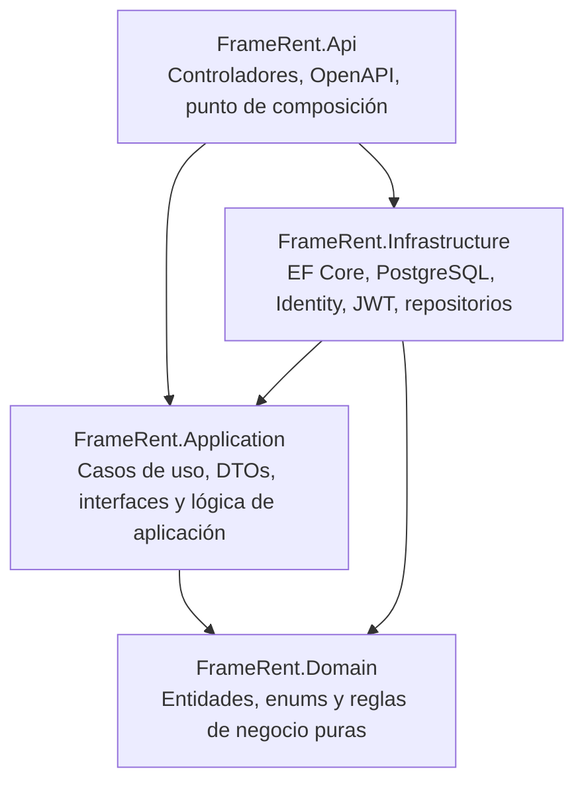

# FrameRent

Sistema de gestión y alquiler de equipos audiovisuales desarrollado con ASP.NET Core Web API (.NET 10), Entity Framework Core, PostgreSQL y Clean Architecture, diseñado para integrarse con un cliente frontend desacoplado.

---

## 1. Descripción general del proyecto

**FrameRent** es una solución empresarial para gestionar el alquiler de equipos técnicos y audiovisuales, como cámaras, ópticas, iluminación, audio, equipos de producción y herramientas auxiliares. El proyecto está pensado como un backend robusto y escalable, separado por capas, con lógica de negocio centrada en el dominio y acceso a datos gestionado por Entity Framework Core.

El sistema cubre funciones clave como:
- gestionar el catálogo de equipos y su stock
- registrar clientes y administradores
- controlar el ciclo de vida completo de un alquiler
- aprobar, rechazar, entregar y devolver equipos
- aplicar reglas de negocio para disponibilidad, fechas y estados
- consultar reportes de equipos más alquilados
- proteger los endpoints con autenticación y autorización por roles

La solución sigue una arquitectura orientada a Clean Architecture, separando dominio, aplicación, infraestructura y API para mantener la lógica del negocio aislada de dependencias externas y del framework.

---

## 2. Arquitectura del sistema

La solución está organizada en cuatro capas principales:



### Responsabilidad de cada capa

| Capa | Proyecto | Responsabilidad |
|---|---|---|
| Domain | `FrameRent.Domain` | Entidades, enums, validaciones y reglas puras del negocio |
| Application | `FrameRent.Application` | Casos de uso, DTOs, interfaces y orquestación del flujo |
| Infrastructure | `FrameRent.Infrastructure` | EF Core, repositorios, Identity, JWT y persistencia |
| API | `FrameRent.Api` | Controladores REST, autenticación, autorización y punto de entrada |

---

## 3. Estructura global de la solución

```text
FrameRent/
├── README.md
├── FrameRent.sln
├── dotnet-tools.json
├── src/
│   ├── FrameRent.Domain/
│   │   ├── Entities/
│   │   │   ├── BaseEntity.cs
│   │   │   ├── Customer.cs
│   │   │   ├── Equipment.cs
│   │   │   ├── Penalty.cs
│   │   │   ├── Rental.cs
│   │   │   └── RentalDetail.cs
│   │   └── Enums/
│   │       └── RentalStatus.cs
│   │
│   ├── FrameRent.Application/
│   │   ├── DTOs/
│   │   ├── Interfaces/
│   │   ├── UseCases/
│   │   ├── DependencyInjection.cs
│   │   └── FrameRent.Application.csproj
│   │
│   ├── FrameRent.Infrastructure/
│   │   ├── Auth/
│   │   ├── Persistence/
│   │   ├── DependencyInjection.cs
│   │   └── FrameRent.Infrastructure.csproj
│   │
│   ├── FrameRent.Api/
│   │   ├── Controllers/
│   │   ├── Program.cs
│   │   ├── appsettings.json
│   │   └── FrameRent.Api.csproj
│   └── ...
```

---

## 4. Capa de Dominio (`FrameRent.Domain`)

### 4.1 Descripción y principios

La capa de dominio es el núcleo de la aplicación. Aquí se definen las entidades, enums y reglas de negocio sin depender de ASP.NET Core, Entity Framework ni cualquier biblioteca concreta de infraestructura.

Principios aplicados:
- encapsulación de reglas de negocio
- validación centralizada en entidades
- separación del modelo de persistencia y del modelo del negocio
- independencia del framework y de la base de datos

### 4.2 Entidades principales

#### `BaseEntity`
Es la clase base para todas las entidades del dominio. Proporciona el identificador único `Id` y usa `Guid` para asegurar unicidad global de cada registro.

#### `Equipment`
Representa un equipo disponible para alquiler. Incluye:
- `Name`
- `Category`
- `Description`
- `DailyRate`
- `TotalUnits`
- `IsActive`

Reglas principales:
- nombre y categoría no pueden estar vacíos
- tarifa por día no puede ser negativa
- cantidad total de unidades debe ser mayor que cero
- estado activo/inactivo controla si el equipo puede aparecer para alquiler

#### `Customer`
Representa al cliente que realiza la solicitud de alquiler. Incluye:
- nombre
- apellidos
- email
- teléfono

Se valida que los datos obligatorios estén presentes y se evitan inconsistencias en la información de contacto.

#### `Rental`
Representa la operación comercial de alquiler. La entidad lleva el control del cliente, las fechas, el total, el estado y el detalle de alquiler.

Propiedades clave:
- `CustomerId`
- `StartDate`
- `EndDate`
- `TotalAmount`
- `Status`
- `Details`

Estados del alquiler:
- `Pending`
- `Approved`
- `Active`
- `Completed`
- `Cancelled`

Reglas de negocio:
- el alquiler debe tener una fecha de fin posterior a la de inicio
- solo puede agregarse detalle mientras el alquiler esté pendiente
- el estado cambia según la validación del flujo comercial
- la colección de detalles se maneja de forma encapsulada para proteger la integridad del agregado

#### `RentalDetail`
Es la línea de detalle del alquiler y representa cada tipo de equipo solicitado dentro del mismo. Guarda la cantidad, la tarifa diaria pactada y el subtotal calculado.

#### `Penalty`
Representa una penalización asociada a un alquiler y registra el motivo, importe y estado de pago.

### 4.3 Enumeración `RentalStatus`

```csharp
public enum RentalStatus
{
    Pending = 0,
    Approved = 1,
    Active = 2,
    Completed = 3,
    Cancelled = 4
}
```

---

## 5. Capa de Aplicación (`FrameRent.Application`)

### 5.1 Descripción

La capa de aplicación contiene la lógica que orquesta los casos de uso del negocio sin depender de la infraestructura ni del tipo concreto de base de datos. Aquí se definen los DTOs de entrada/salida, las interfaces de repositorio y los casos de uso.

### 5.2 Objetivos de la capa

- coordinar la lógica de negocio del sistema
- definir contratos para acceso a datos
- mantener el dominio limpio y aislado
- preparar el flujo para que la API la consuma sin acoplarse a infraestructura

### 5.3 Casos de uso implementados

Se han implementado los principales casos de uso del negocio para:
- crear equipos
- consultar equipos
- actualizar equipos
- activar/desactivar equipos
- crear alquileres
- consultar alquileres del cliente
- consultar alquileres del personal
- aprobar/rechazar/cancelar entregas
- gestionar devolución y cierre del alquiler
- consultar top equipos más alquilados

### 5.4 Interfaces de repositorio

Las interfaces de repositorio se declaran en la capa de aplicación para permitir la inversión de dependencias. Esto hace que el caso de uso dependa del contrato y no de la implementación concreta.

Ejemplo de repositorios clave:
- `IEquipmentRepository`
- `IRentalRepository`
- `ICustomerRepository`

---

## 6. Capa de Infraestructura (`FrameRent.Infrastructure`)

### 6.1 Descripción

La capa de infraestructura es la encargada de conectarse con detalles externos como:
- base de datos PostgreSQL
- Entity Framework Core
- Identity
- JWT
- repositorios concretos
- configuración del sistema

### 6.2 Entity Framework Core

Se usa EF Core para mapear el dominio a la base de datos y permitir la persistencia mediante modelado Code First.

### 6.3 Identity y JWT

Se integra ASP.NET Core Identity para manejar usuarios, roles y autenticación segura del sistema. Además, se implementa JWT para emitir tokens de acceso a clientes autenticados.

Roles configurados:
- `Customer`
- `Staff`

### 6.4 Usuario administrador inicial

Se crea un usuario de tipo personal al iniciar la aplicación:
- Email: `admin@framerent.local`
- Password: `Admin123!`

Este usuario se asigna al rol `Staff`.

---

## 7. Capa de Presentación / API (`FrameRent.Api`)

### 7.1 Punto de entrada

La capa API es la que expone la funcionalidad del sistema a través de endpoints HTTP. Aquí se registran los servicios, se configura la autenticación JWT y se exponen los controladores.

### 7.2 Controladores principales

Se implementan controladores para:
- `AuthController`
- `EquipmentController`
- `RentalsController`
- `ReportsController`

### 7.3 Endpoints de autenticación

```http
POST /api/v1/auth/register
POST /api/v1/auth/login
```

### 7.4 Endpoints de equipos

```http
GET /api/equipment
GET /api/equipment/{id}
POST /api/equipment
PUT /api/equipment/{id}
PATCH /api/equipment/{id}/activate
PATCH /api/equipment/{id}/deactivate
```

### 7.5 Endpoints de alquileres

```http
POST /api/v1/rentals
GET /api/v1/rentals/mine
GET /api/v1/rentals/{id}
GET /api/v1/rentals
PATCH /api/v1/rentals/{id}/cancel
PATCH /api/v1/rentals/{id}/approve
PATCH /api/v1/rentals/{id}/reject
PATCH /api/v1/rentals/{id}/deliver
PATCH /api/v1/rentals/{id}/return
```

### 7.6 Reportes

```http
GET /api/v1/reports/top-equipment?limit=10
```

---

## 8. Roles y permisos

El flujo de autorización del sistema contempla dos perfiles principales:

- `Customer`: puede registrarse, iniciar sesión, crear alquileres y consultar sus propios registros
- `Staff`: puede gestionar alquileres, aprobar, rechazar, entregar, devolver y consultar reportes

La protección se aplica con `[Authorize]`, `[Authorize(Roles = "Customer")]` y `[Authorize(Roles = "Staff")]` en los controladores de la API.

---

## 9. Cambios realizados en el proyecto

Se corrigieron errores de integración y se completó la base funcional del proyecto, entre otros cambios:

- completada la interfaz `IEquipmentRepository`
- implementado `EquipmentRepository`
- registrados los casos de uso faltantes en la inyección de dependencias
- añadida infraestructura de Identity
- añadida generación JWT
- creada la autenticación con tokens para usuarios
- implementados controladores de auth, rentals y reports
- añadida lógica de alquiler con estados y permisos por rol
- ajustada la compilación final del proyecto

La solución compila correctamente con:

```bash
dotnet build
```

---

## 10. Requisitos para ejecutar

1. Instalar .NET SDK 10.
2. Tener PostgreSQL disponible localmente o en un servidor accesible.
3. Configurar la cadena de conexión en `src/FrameRent.Api/appsettings.json`.
4. Ejecutar los siguientes comandos:

```bash
dotnet restore
dotnet build
dotnet run --project src/FrameRent.Api/FrameRent.Api.csproj
```

---

## 11. Configuración de base de datos

El proyecto usa Entity Framework Core con PostgreSQL y está preparado para Code First.

Ejemplo de migración:

```bash
dotnet ef database update --project src/FrameRent.Infrastructure --startup-project src/FrameRent.Api
```

---

## 12. Estado real del proyecto

El backend de FrameRent ya quedó en una etapa funcional y sólida. La API permite:
- autenticarse
- registrar clientes
- consultar y crear equipos
- gestionar alquileres
- autorizar por perfiles
- generar reportes de uso
- compilar correctamente

No obstante, para hablar de un ejercicio completamente entregado en sentido académico amplio, aún quedan aspectos que dependen del alcance final requerido por el enunciado original, como:
- completar la capa de presentación o frontend
- validar funcionalmente el flujo completo con pruebas reales
- revisar cada requisito del PDF uno por uno
- dejar la entrega final completamente cerrada para presentación formal

Por tanto, el estado actual del proyecto es:
- backend funcional
- arquitectura sólida
- solución compilable
- progreso real hacia la entrega del ejercicio

---

## 13. Nota final

Este README refleja el estado real del proyecto y la base técnica que ya quedó implementada. FrameRent cuenta con una estructura limpia, autenticación, flujo de alquileres, autorización por roles y reportes funcionales.

La solución compila correctamente y la base del backend está preparada para continuar con la entrega final del ejercicio, según lo exigido por el enunciado original.
