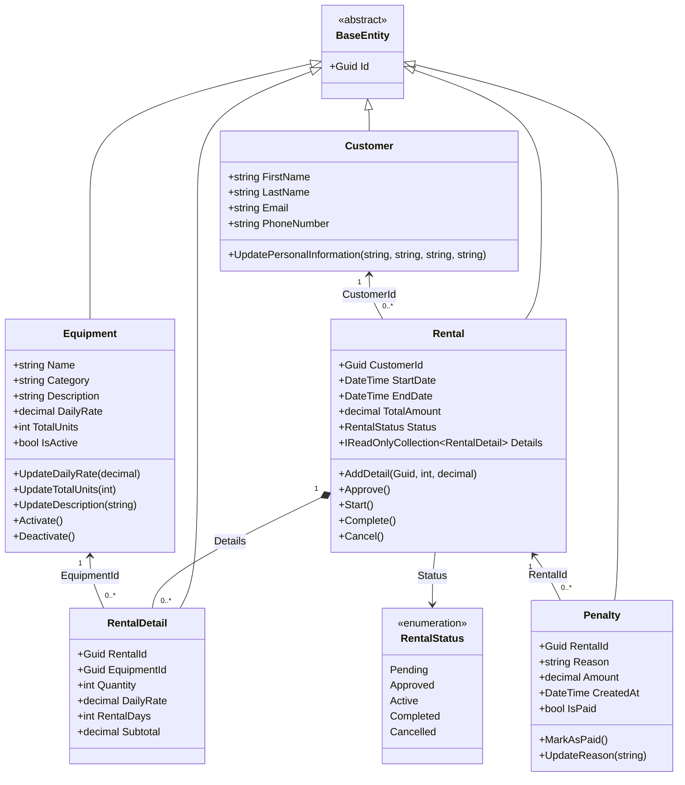

# FrameRent — Capa de dominio

## 1. Descripción general

La capa **Domain (Dominio)** contiene los conceptos principales y las reglas de negocio de FrameRent, un sistema de alquiler de equipos. Representa las entidades del negocio y las reglas que protegen sus datos frente a cambios inválidos.

La capa Domain **no depende** de la API, Application, Infrastructure, Entity Framework Core ni de una base de datos específica. Las demás capas pueden utilizar sus entidades, mientras las reglas del negocio se mantienen independientes de los detalles técnicos.

## 2. Estructura actual

```text
FrameRent.Domain/
├── Entities/
│   ├── BaseEntity.cs
│   ├── Equipment.cs
│   ├── Customer.cs
│   ├── Rental.cs
│   ├── RentalDetail.cs
│   └── Penalty.cs
└── Enums/
    └── RentalStatus.cs
```

## 3. Clases y responsabilidades

### `BaseEntity`

- Es una clase base abstracta de la que heredan las entidades del dominio.
- Define la propiedad `Id`, de tipo `Guid`.
- Genera un identificador nuevo con `Guid.NewGuid()`.
- Utiliza un setter `protected` para que las entidades derivadas controlen cómo se modifica el identificador.
- Es abstracta, por lo que no está pensada para crear objetos directamente a partir de ella.

### `Equipment`

Representa un equipo o tipo de equipo disponible para alquilar.

Propiedades principales:

- `Name`: nombre del equipo.
- `Category`: categoría del equipo.
- `Description`: descripción del equipo.
- `DailyRate`: precio del alquiler por día.
- `TotalUnits`: cantidad total de unidades que se poseen.
- `IsActive`: indica si el equipo está activo para el negocio de alquiler.

Comportamiento principal:

- Valida que el nombre y la categoría sean obligatorios.
- Rechaza una tarifa diaria negativa y una cantidad de unidades menor o igual a cero.
- Elimina espacios innecesarios al inicio y al final de los textos.
- Permite actualizar la tarifa diaria, la cantidad total de unidades y la descripción.
- Permite activar o desactivar el equipo.

**Importante:** comprobar si hay suficientes unidades disponibles para un periodo específico requiere lógica adicional. `TotalUnits` por sí sola no representa la disponibilidad para unas fechas concretas.

### `Customer`

Representa a un cliente que puede alquilar equipos.

Propiedades principales:

- `FirstName`: nombre.
- `LastName`: apellido.
- `Email`: correo electrónico.
- `PhoneNumber`: número de teléfono.

Comportamiento principal:

- Exige nombre, apellido y correo electrónico.
- Elimina espacios innecesarios al inicio y al final de los textos.
- Permite actualizar la información personal del cliente.

La entidad actualmente verifica que el correo no esté vacío. La validación de su formato y la comprobación de que no esté repetido pueden agregarse en la capa correspondiente.

### `Rental`

Representa una operación de alquiler realizada por un cliente.

Propiedades principales:

- `CustomerId`: identificador del cliente asociado al alquiler.
- `StartDate` y `EndDate`: periodo del alquiler.
- `TotalAmount`: total calculado a partir de los detalles del alquiler.
- `Status`: estado actual del alquiler.
- `Details`: vista de solo lectura de los detalles del alquiler.

Comportamiento principal:

- Valida el identificador del cliente y las fechas del alquiler.
- Agrega detalles mientras el alquiler está pendiente.
- Recalcula el total a partir de los detalles.
- Permite cambiar de estado mediante métodos como `Approve()`, `Start()`, `Complete()` y `Cancel()`.
- Exige al menos un detalle antes de aprobar el alquiler.

La colección `Details` se expone como `IReadOnlyCollection<RentalDetail>`, mientras la lista interna se mantiene privada. Así se evita que otras clases modifiquen directamente la colección.

### `RentalDetail`

Representa una línea dentro de un alquiler: el equipo, la cantidad, la tarifa diaria, el número de días y el subtotal calculado.

Propiedades principales:

- `RentalId`: identificador del alquiler.
- `EquipmentId`: identificador del equipo alquilado.
- `Quantity`: cantidad de unidades alquiladas.
- `DailyRate`: precio diario registrado para este detalle.
- `RentalDays`: número de días del alquiler.
- `Subtotal`: se calcula como `Quantity × DailyRate × RentalDays`.

Comportamiento principal:

- Valida los identificadores del alquiler y del equipo.
- Exige una cantidad y un número de días mayores que cero.
- Rechaza una tarifa diaria negativa.
- Calcula el subtotal al crear el detalle.

Guardar la tarifa diaria en el detalle permite conservar el precio aplicado a ese alquiler, aunque la tarifa actual del equipo cambie más adelante.

### `Penalty`

Representa una penalización asociada a un alquiler.

Propiedades principales:

- `RentalId`: identificador del alquiler relacionado.
- `Reason`: explicación de la penalización.
- `Amount`: valor de la penalización.
- `CreatedAt`: fecha y hora de creación.
- `IsPaid`: indica si la penalización ya fue pagada.

Comportamiento principal:

- Exige un identificador de alquiler válido y una razón no vacía.
- Exige que el valor de la penalización sea mayor que cero.
- Establece `CreatedAt` con la hora UTC al crear la penalización.
- La penalización comienza sin pagar.
- `MarkAsPaid()` la marca como pagada y evita marcarla como pagada dos veces.
- `UpdateReason()` permite actualizar la razón después de validarla.

### `RentalStatus`

Es un `enum` que define los posibles estados de un alquiler:

- `Pending`: pendiente de aprobación.
- `Approved`: aprobado.
- `Active`: en curso.
- `Completed`: finalizado.
- `Cancelled`: cancelado.

Utilizar un `enum` evita representar estos estados conocidos como texto arbitrario. Los cambios permitidos de estado se controlan mediante los métodos de `Rental`.

## 4. Cómo se conectan las clases

- **`Equipment`, `Customer`, `Rental`, `RentalDetail` y `Penalty` heredan de `BaseEntity`.** Todas reciben la propiedad común `Id`.
- **`Rental` → `Customer`:** `Rental.CustomerId` identifica al cliente que realizó el alquiler. El modelo actual guarda el identificador; todavía no se ha definido una propiedad de navegación.
- **`Rental` → `RentalDetail`:** un alquiler puede contener varios detalles. Cada detalle es una línea del alquiler. `Rental` administra los detalles mediante `AddDetail()` y calcula `TotalAmount` a partir de sus subtotales.
- **`RentalDetail` → `Equipment`:** `RentalDetail.EquipmentId` identifica el equipo incluido en la línea. El modelo actual guarda el identificador; todavía no se ha definido una propiedad de navegación.
- **`Penalty` → `Rental`:** `Penalty.RentalId` identifica el alquiler al que pertenece la penalización.
- **`Rental` → `RentalStatus`:** cada alquiler tiene un estado actual representado por el `enum`.

Estos identificadores expresan las relaciones del dominio. Las claves foráneas de la base de datos y los mapeos de Entity Framework Core se configurarán posteriormente en Infrastructure.

## 5. Diagrama de clases (Mermaid)

El siguiente diagrama se puede visualizar en editores Markdown compatibles con Mermaid.



**Nota sobre el diagrama:** las líneas de relación de `Customer`, `Equipment` y `Penalty` representan los identificadores almacenados por el modelo actual. Todavía no se han agregado las propiedades de navegación correspondientes. El diagrama describe el diseño actual del dominio, pero por sí solo no configura las relaciones de la base de datos.

## 6. Límites actuales del diseño y trabajo futuro

- La capa Domain contiene entidades y reglas de negocio; no accede directamente a la base de datos.
- `Application` contendrá los casos de uso y abstracciones como las interfaces de repositorio.
- `Infrastructure` implementará el acceso a datos y los mapeos de Entity Framework Core.
- `Api` expondrá endpoints HTTP para que el frontend desacoplado pueda consumirlos.
- La comprobación de disponibilidad para un rango de fechas, la unicidad del correo y las relaciones de base de datos aún deben implementarse o configurarse en las capas correspondientes.
- El cálculo de los días del alquiler y el significado exacto de la fecha final deben coincidir con la política de negocio que se decida para FrameRent.
